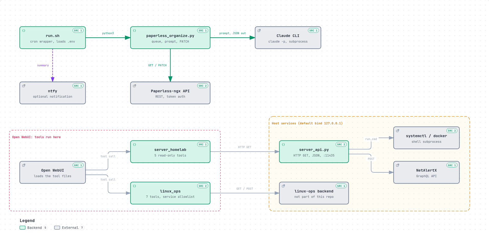

# homelab-ai

Small, dependency-light Python automation I run on my home server:

| Component | What it does |
|---|---|
| [`paperless-organize/`](paperless-organize) | Daily cron job that classifies OCR'd documents in [Paperless-ngx](https://docs.paperless-ngx.com/) (title, correspondent, document type, tags) by calling the **Claude CLI**, and writes the result back through the Paperless REST API. |
| [`openwebui-tools/`](openwebui-tools) | Two [Open WebUI](https://openwebui.com/) tools (tool calling): `server_homelab` (read-only status: host, containers, services, devices, presence) and `linux_ops` (network diagnostics, plus restart actions behind `confirmed=true` and a service allowlist). |
| [`server-api/`](server-api) | A tiny read-only HTTP/JSON service (stdlib `http.server`) that the Open WebUI tools query. |

Everything uses the standard library only at runtime. `pytest` and `ruff` are dev-only.

## Architecture



Primary path (highlighted): `cron` runs `run.sh`, which starts `paperless_organize.py`; the job sends a compact prompt to the Claude CLI and `PATCH`es the classification it returns to the Paperless-ngx API. The Open WebUI tools and the read-only `server-api` form a second, independent flow. Interactive version: [`docs/architecture/architecture.html`](docs/architecture/architecture.html) (generated with [Archify](https://github.com/tt-a1i/archify) from [`architecture.spec.json`](docs/architecture/architecture.spec.json)).

## Flow

```
                 ┌─────────┐   claude -p <prompt>   ┌────────────┐
  cron 07:00 ──▶ │ run.sh  │ ─────────────────────▶ │ Claude CLI │
                 └────┬────┘ ◀───── JSON only ───── └────────────┘
                      │ paperless_organize.py
                      │  GET  /api/documents/  (no `ai-processed` tag)
                      │  GET  /api/documents/{id}/suggestions/
                      ▼  PATCH /api/documents/{id}/  (+ `ai-processed`)
                ┌──────────────┐
                │ Paperless-ngx│
                └──────────────┘

  user ─▶ Open WebUI ─▶ local LLM (OpenAI-compatible API, tool calling)
                │                 └─ picks a tool
                ▼
        openwebui-tools/*.py ──HTTP──▶ server-api (read-only) ─▶ systemd / docker / NetAlertX
                              └─HTTP─▶ linux-ops backend (actions, not included)
```

## Setup

```bash
cp .env.example .env && chmod 600 .env   # fill in values; never commit .env
pip install -r requirements-dev.txt      # only needed for tests / lint
```

* **paperless-organize**: set `PAPERLESS_API_URL`, `PAPERLESS_TOKEN`, optionally `AI_BIN` / `AI_MODEL` (defaults `claude` / `sonnet`; the CLI must already be logged in for the cron user).
  ```bash
  python3 paperless-organize/paperless_organize.py --init       # create the controlled vocabulary
  python3 paperless-organize/paperless_organize.py --dry-run    # show proposals, write nothing
  ./paperless-organize/run.sh                                   # full run (+ optional ntfy notification)
  ```
  Idempotency: only documents without the `ai-processed` tag are queued; remove the tag to re-classify one.
  Token-aware: controlled vocabulary + Paperless' own suggestions + OCR truncated to 1500 chars, `--limit` cap per run.
* **server-api**: `python3 server-api/server_api.py` (see `.env.example`; binds to `127.0.0.1` by default).
* **openwebui-tools**: paste each file into *Workspace → Tools* in Open WebUI and set the environment variables (`SERVER_API_BASE`, `LINUX_OPS_API_BASE`, `LINUX_OPS_ALLOWED_SERVICES`) on the container.

## Tests and lint

```bash
pytest -q        # offline: HTTP, subprocess and the Claude CLI are mocked
ruff check .
```

CI (GitHub Actions) runs both on every push and pull request.

## History

The job originally called the Gemini CLI; when Google retired it for individual accounts it was switched to the Claude CLI (the call is isolated in `ask_ai`, configurable via `AI_BIN` / `AI_MODEL`).

## Known limitations

* The Paperless job does little work: new documents are rare, so most daily runs find an empty queue (it classified a few dozen documents in total, so far).
* Tool calling was verified at the model level (the local model returns a well-formed `tool_calls`); I have not automated an end-to-end test through Open WebUI.
* If the Paperless `PATCH` fails, the exception propagates and aborts that run (the error is logged to stderr); remaining documents are picked up the next day because they are still untagged.
* The `linux-ops` backend that executes the actions behind `linux_ops` is not part of this repo; the tool only enforces confirmation and an allowlist client-side.
* Restic backups, Tailscale, Beszel and the rest of the server setup are not included.
* Code comments and prompts are mostly in Italian.

## License

MIT
